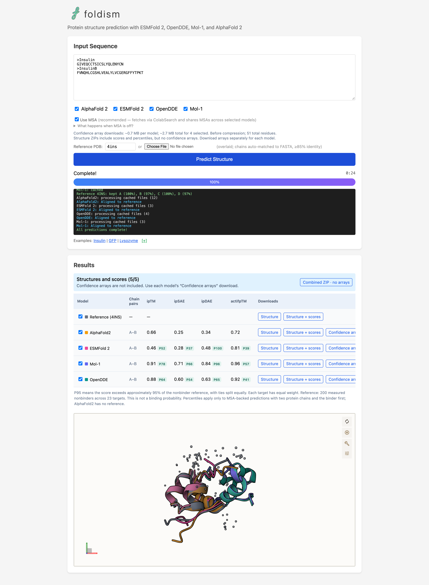

# Foldism

Multi-algorithm protein structure prediction using Modal serverless infrastructure.

Runs **AlphaFold 2**, **ESMFold 2**, **OpenDDE**, and **Mol-1**.



## Quick Start

Set up uv and modal (mac and linux)
```bash
curl -LsSf https://astral.sh/uv/install.sh | sh
uvx modal setup
```

Run dev server or deploy to Modal
```bash
uvx modal serve foldism.py
uvx modal deploy foldism.py
```

## Command Line Interface

Run basic tests on command line
```bash
echo -e ">Insulin\nGIVEQCCTSICSLYQLENYCN\n>InsulinB\nFVNQHLCGSHLVEALYLVCGERGFFYTPKT" > input.faa
uvx modal run foldism.py --input-faa input.faa
uvx modal run foldism.py --input-faa input.faa --algorithms esmfold2,mol1
uvx modal run foldism.py --input-faa input.faa --no-use-msa  # faster but lower quality
```

## MSA pipeline
- All backends share a single ColabSearch/MMseqs2 MSA fetch (Sokrypton's API),
  cached on a Modal Volume by sequence-set hash.
- ESMFold 2 can run with MSA (PLM + MSA, more accurate) or without (`--no-use-msa`,
  PLM-only, faster).

## Confidence scores
For every pair of protein chains, each backend reports ipTM, ipSAE, ipDAE and actifpTM.
Two-chain runs with MSA on ESMFold 2, OpenDDE and Mol-1 also show a percentile rank against
measured non-binders from ProteinBase (Adaptyv Bio, https://proteinbase.com), shared under
[ODC-BY 1.0](https://opendatacommons.org/licenses/by/1-0/).

## Credits and licenses
- ipSAE: [Dunbrack lab IPSAE](https://github.com/DunbrackLab/IPSAE) (MIT).
- ipDAE: reimplements the definition in [BindCraft2](https://github.com/PacesaLab/BindCraft2)
  (Martin Pacesa, University of Zurich), which has a source-available license that restricts
  offering it to third parties as a hosted service. Read it before hosting foldism publicly.
- actifpTM: Varga et al., Bioinformatics 41(3), btaf107.
- Foldism does not redistribute model weights. Each backend downloads its model from the
  authors at image build time. Check each model's license for your use:
  ESMFold 2 and ESMC (Hugging Face, `biohub`), OpenDDE (Hugging Face, `aurekaresearch`),
  Mol-1 ([molence/Mol-1](https://github.com/molence/Mol-1)), AlphaFold 2 (via ColabFold).

## Cost
- Modal currently gives you $30 per month free to experiment with
- A run with all 4 methods can cost **$1+** depending on sequence length (GPUs cost $1-4 per hour)
- Results are cached, so re-running the same sequence is almost free
- If you `modal deploy`, the URL is publicly available (anyone who finds it can use it)
- If you want to require users to authenticate, set up a [custom domain](https://modal.com/docs/guide/webhook-urls).
  I use cloudflare but there are many ways to do this.

## License

Foldism code: MIT.

The percentile reference table inside `backends/confidence.py` is derived from public ProteinBase
data (Adaptyv Bio) and is shared under [ODC-BY 1.0](https://opendatacommons.org/licenses/by/1-0/).
ipSAE (MIT) and ipDAE (BindCraft2's source-available license) keep their own licenses; see Credits.
